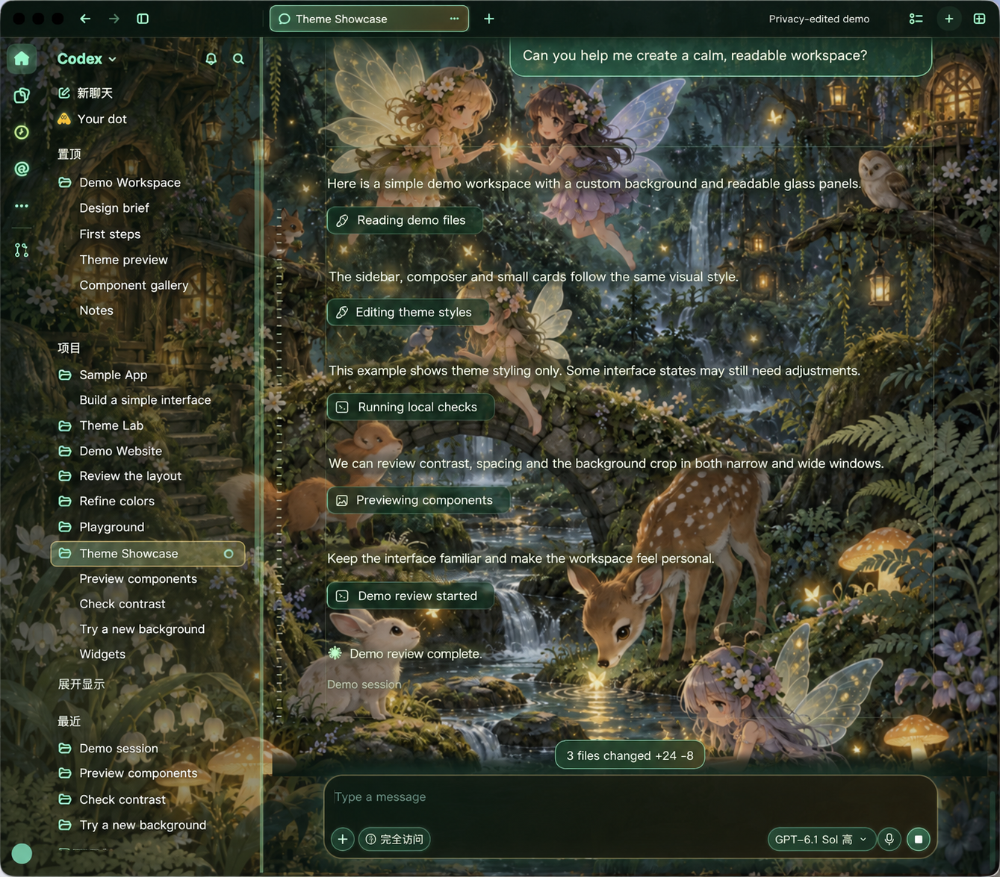
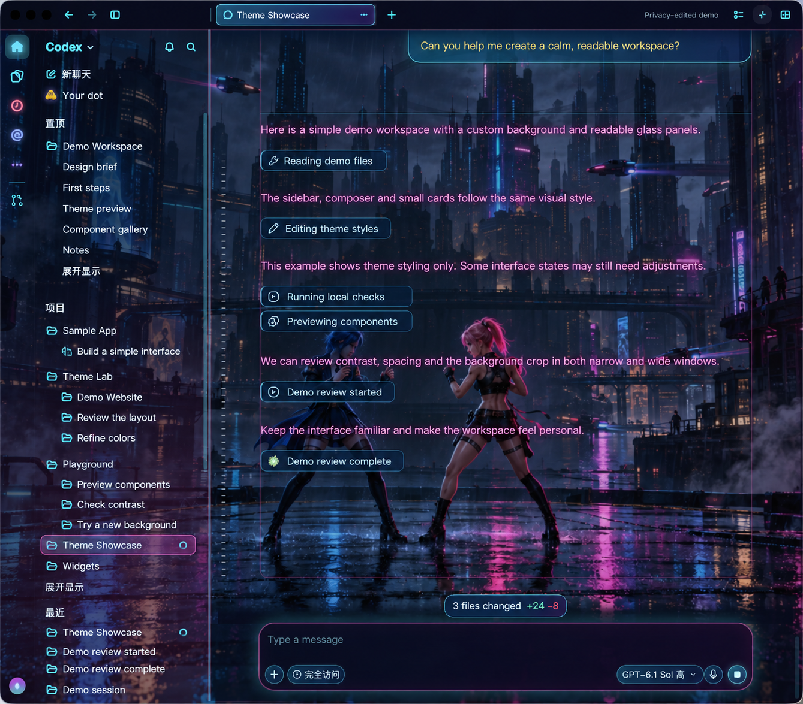

# Codex Appearance Manager

[English](README.md)

让 Codex 基于长期使用中积累的 CSS 适配，帮你创建自己喜欢的 Codex 主题。

这个非官方、仅在本机运行的 macOS 工具，将我们长期使用中捕捉到的界面选择器和样式修复公开出来，包括输入框、小浮窗、短暂出现的卡片等容易遗漏的细节。你可以让 Codex 协助编译安装，再沿用这些已有规则设计自己的主题，减少重新定位每个界面组件的工作。奇幻森林与科幻雨夜是参考示例和起点，不是项目的最终目的。

管理器支持编辑 CSS、按需注入和恢复原样，不修改 Codex 安装包。AI 协助安装取决于本机环境和授权；项目没有提供保证无人值守的一键安装器，也不是能自动完整覆盖任意界面的主题生成器。

## 状态与覆盖范围

当前是**实验性源码版本**，不是稳定版，也不是官方支持的扩展。源码、CSS、脚本、项目自编文档及项目自有图片采用 [MIT](LICENSE) 许可证；不包含第三方权利，见[资源与授权说明](docs/assets-and-licensing.md)。

**我们不保证已经覆盖 Codex 的所有界面组件、弹窗或交互状态。** 两套主题积累了大量实际使用中发现的细节适配，但少见对话框、新增功能、DOM 结构变化以及不同 Codex 版本，仍可能出现原生浅色背景、漏样式、文字对比不足或局部布局问题。自动化测试和选择器预检通过，不代表全部界面都经过视觉验证，详见[兼容范围与限制](docs/compatibility.md)。

本项目与 OpenAI 无隶属或背书关系。它只改变界面外观，不增加模型能力或订阅功能。

## 两套参考主题

这两套主题展示了同一批适配积累的不同视觉方向。创建新风格时，应复用完整样式表，保留零碎组件的覆盖，不要用一小段新 CSS 替换掉已有修复。目前 CSS 是实用的制作起点，还没有完全拆分成“通用覆盖层＋只改调色板”的主题框架。

| 主题 | 风格 | 包 ID |
| --- | --- | --- |
| Enchanted Forest · 奇幻森林 | 月光森林、小动物与带翅膀的精灵、深绿玻璃面板、薄荷绿与金色点缀 | `aurora-neon` |
| Rainy Neon · 科幻雨夜 | 雨夜未来都市、半透明深蓝面板、青色与粉色霓虹 | `rainy-neon` |

森林主题保留历史 ID `aurora-neon`，不要仅为名称一致而直接改名。本快照仅附带两套主题正在使用的背景，以及所有者已确认的两张使用虚构内容的[脱敏展示图](docs/previews/README.md)。图片经过 AI 编辑，可能改变文字、间距或图标等细节，不是未经编辑的原始截图，也不作为界面验收证据。原始私人聊天截图未纳入。

### 奇幻森林



### 科幻雨夜



## 环境要求

- macOS 14 或更新版本。
- 支持 Swift tools 6.0 或更新版本的 Swift 工具链和 macOS SDK，可使用适合系统的 Apple Command Line Tools 或 Xcode；用 `swift --version` 检查。
- 本机安装 Codex Desktop。默认检查 `/Applications/Codex.app`，再检查 `/Applications/ChatGPT.app`；后者是路径回退，不代表支持所有 ChatGPT 应用版本。当前 GUI 没有其他安装路径选择器。
- Swift 包没有声明第三方包依赖。本应用不支持 Windows 或 Linux。

## 让 Codex 帮你安装和创建主题

在 Codex 中打开一个可访问你选定工作目录的本地任务，可以直接复制下面的提示词，并替换主题描述。这些是操作建议，不是已经验证的一键自动化；请留意操作范围和权限请求。

### 安装提示词

```text
请帮我在这台 Mac 上配置 https://github.com/collin520/codex-appearance-manager。
已有本地仓库就复用，否则克隆到我们确认的目录。
先阅读 README.zh-CN.md、docs/security.md 和 docs/validation.md，检查 macOS
及 Swift 工具链；安装缺失工具或覆盖文件之前先问我。
按文档运行测试、Release 构建和打包脚本，告诉我生成的应用位置，
并说明手动连接、注入和恢复步骤。
不要修改 Codex 安装包、强制退出或重启 Codex、自动注入，或关闭系统保护。
遇到环境或权限问题时停止并说明，不要绕过限制。
```

### 定制主题提示词

```text
请基于 Codex Appearance Manager 创建一个独立的新主题，风格是：
【填写喜欢的配色、氛围、背景、字体偏好，以及通常全屏还是半屏使用】。
先阅读 docs/theme-format.md 和一套参考主题的完整 CSS。
保留已有选择器、嵌套组件修复和控件功能，不删掉零碎组件的覆盖。
给新主题使用独立、合法的 ID，更新所有主题根作用域；主题专属的 CSS
变量和动画名称如需改名，也要同步更新所有引用。
调整配色、渐变、边框、阴影和本地背景资源，并检查硬编码颜色，
保证文字对比度，保留差异增删、错误等语义颜色。
先备份本地修改，不覆盖原来的两套主题；默认不改 Swift 代码。
涉及主题 ID 绑定的 Shadow DOM 适配时，单独说明所需改动。
检查包结构和资源引用，运行现有源码测试，再指导我重新加载管理器、
重新读取编辑框草稿，并明确点击注入；未实际检查的界面请列为未验证。
```

创建步骤和特殊限制见[主题制作说明](docs/theme-format.md#reuse-the-existing-coverage)。

## 下载源码后编译

在仓库根目录运行：

```sh
swift run CodexAppearanceTestRunner
swift build -c release
./scripts/package-app.sh
```

生成的应用位于 `dist/Codex Appearance Manager.app`，可在 Finder 中打开。构建缓存和 `dist/` 已忽略，不属于应上传的源码文件。

脚本使用本地临时签名（ad-hoc），不是 Developer ID 签名或 Apple 公证，也不能证明其他 Mac 一定能安装运行。此次整理不提供预编译下载。实际验证结果及边界见[验证记录](docs/validation.md)。

## 注入与恢复

1. 打开管理器，选择主题。仅打开管理器不会自动改变 Codex。
2. 点击 **Check Codex Connection**。已有兼容的本机调试连接时，可直接到第 5 步。
3. 如果没有连接，先保存工作和未发送的输入，再手动用 `⌘Q` 完全退出 Codex。
4. 点击 **Restart Codex and Inject** 并确认。这个按钮实际只以本机调试参数重新打开 Codex，不会立即注入；窗口出现后点击 **Check Codex Connection**。
5. 连接成功后点击 **Inject Codex Style**。它会先保存当前 CSS 编辑框草稿，再预检选择器并注入；预检不通过会阻止注入，但不会撤销之前的草稿保存。
6. 需要恢复时，在本机调试连接仍可用的情况下点击 **Restore Original**。

管理器不会强制关闭 Codex，仍在运行时会拒绝重新启动。关闭管理器不撤销当前窗口的样式；退出 Codex 后正常重新打开，进程内样式和本次调试会话自然结束。恢复按钮本身不会关闭调试端口、撤销已保存的 CSS，或清除其他工具的改动。

## 主题编辑与更新

点击 **Open Themes Folder** 查看本机主题目录：

```text
~/Library/Application Support/CodexAppearanceManager/themes/
```

每套主题包含 `manifest.json`、`style.css` 和图片。程序会补充缺失的内置文件，但保留已有 CSS 和 manifest，因此重新编译不会自动覆盖安装过的旧主题。

**注意外部编辑冲突：** 注入会保存编辑框草稿。如果管理器打开期间，你在其他编辑器中改了 CSS，先备份，再切换到另一主题并切回来重新读取文件，最后注入。目前没有外部修改冲突检测；切换主题也可能丢弃未保存的草稿。

主题格式、选择器和可移植图片引用见[主题格式说明](docs/theme-format.md)。

## 安全与反馈

默认调试连接为 `127.0.0.1:39222`。CDP 是能力很强的本机调试接口，不是安全沙箱，不应暴露到网络。自定义 CSS 可能遮挡控件或加载外部资源，只使用可信主题，详见[安全边界](docs/security.md)。

发现漏样式、文字难读或控件被遮挡时，先恢复原样，再[提交 GitHub Issue](https://github.com/collin520/codex-appearance-manager/issues/new/choose)。请提供 Codex 版本和 build、macOS 版本、管理器版本或源码版本、主题名称、复现步骤及脱敏截图；不要上传令牌、个人路径或私人对话。问题模板支持中英文填写。

安全问题不要在公开 Issue 中贴可利用的漏洞细节或敏感证据，见[安全反馈边界](docs/security.md#recovery-and-reports)。

## 参与适配

源码包含核心逻辑、SwiftUI 界面、启动入口和轻量测试运行器；打包脚本在 `scripts/`，图标在 `assets/`，主题在 `Sources/CodexAppearanceApp/Resources/StarterThemes/`。

修改共享选择器后请检查两套主题，保持规则限定在主题根节点内，不改变控件功能。运行测试和 Release 构建；有真实界面时按[手工验收清单](docs/manual-acceptance.md)检查。不要把 DOM 模拟或源码字符串测试写成原生界面已验证。
